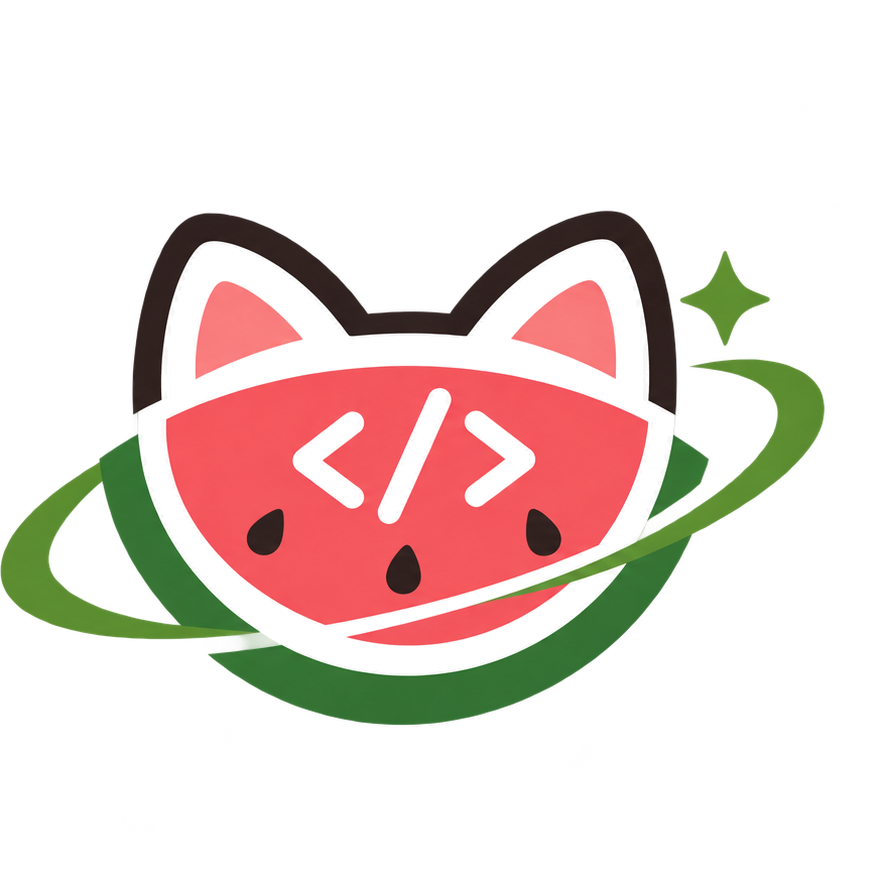
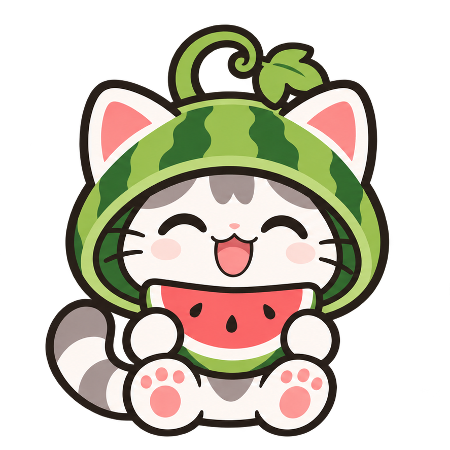

 <div align="center">



# 🍉 瓜大的小喵喵喵喵 🐈

### Nekos in Watermelon University

**一群来自西瓜大的野生程序喵。**

*A bunch of coding nekos from Watermelon University.*



[](https://github.com/Nekos-in-Watermelon-University)


**Code. Create. Explore. Meow.**

[简体中文](#-简体中文) · [English](#-english)

</div>

---

# 🇨🇳 简体中文

## 🐱 关于我们

你好，世界！这里是 **瓜大的小喵喵喵喵**！

我们是一群来自 **西北工业大学（NWPU）** 的学生。

因为学校被亲切地称为「西瓜大」，而我们又恰好是一群喜欢写代码、折腾技术、探索新事物的小猫咪，于是便有了这个名字。

我们可能在研究复杂的算法，也可能在折腾操作系统、编译器和人工智能；当然，也可能只是突发奇想，花上一个周末写出某个毫无实际用途但非常有趣的东西。

> **不一定要有用，但一定要好玩。**

## 🍉 认识一下西瓜喵

<div align="center">


**西瓜喵 · Watermelon Neko**

*本组织首席卖萌官兼代码审查员（虽然它可能只会喵喵叫）。*

</div>

西瓜喵是一只戴着西瓜帽、热爱编程的小猫咪，也是我们组织的吉祥物。

它充满好奇心，喜欢探索新技术、创造有趣的项目，以及在程序运行失败时发出一声疑惑的「喵？」。

据说它最喜欢的事情是吃西瓜、写代码，以及在编译器报错时假装无事发生。

## 🚀 我们在做什么？

| 方向 | 我们感兴趣的东西 |
|:---|:---|
| 🧩 算法与竞赛 | 算法、数据结构、程序设计竞赛 |
| ⚙️ 系统与底层 | 操作系统、编译器、体系结构 |
| 🤖 人工智能 | 机器学习、大语言模型、智能体 |
| 🌐 软件开发 | Web、App、开发工具 |
| 🎮 创意编程 | 游戏开发、模拟器、有趣的实验 |
| 🐈 奇怪的东西 | 一切值得折腾的脑洞 |

我们的仓库里可能有严肃的技术项目，也可能有一些令人摸不着头脑的抽象作品。

毕竟，**谁规定写代码一定要有正经理由呢？**

## 🍉 小喵喵的哲学

```typescript
interface Neko {
  university: "NPU";
  curiosity: number;
  happiness: number;
}

const neko: Neko = {
  university: "NPU",
  curiosity: Infinity,
  happiness: 100,
};

while (neko.curiosity > 0) {
  const idea = getRandomIdea();

  try {
    const project = build(idea);
    openSource(project);
    neko.happiness++;
  } catch (error) {
    console.log("喵？怎么又炸了！");
    learn(error);
  }
}
```

## 🌱 加入我们

无论你是算法高手、系统魔法师、AI 炼丹师、前端艺术家，还是刚刚开始学习编程的萌新，只要你喜欢创造和探索，都欢迎与我们交流！

我们相信：

- **好奇心比技术栈更重要。**
- **分享知识比独自造轮子更有趣。**
- **优秀的项目可以从一个荒诞的想法开始。**
- **开源不仅是分享代码，更是分享创造的快乐。**

希望这里能够成为一群小猫咪分享知识、交流技术、共同创造的地方。

## 📜 关于组织

本组织由西北工业大学学生自发建立和维护，是一个非官方的技术兴趣与开源社区。

组织内的项目、内容及观点均不代表学校官方立场。

---

# 🇬🇧 English

## 🐱 About Us

Hello, World! Welcome to **Nekos in Watermelon University**!

We are a group of students from **Northwestern Polytechnical University (NWPU)**, China.

Our university is affectionately nicknamed *Watermelon University*, and we're just a bunch of curious nekos who love coding, exploring technology, and building interesting things.

And that's how **Nekos in Watermelon University** came to life.

Some of us enjoy solving challenging algorithmic problems. Others love tinkering with operating systems, compilers, and artificial intelligence.

And sometimes, we spend an entire weekend building something completely unnecessary, simply because the idea sounds fun.

> **Not everything has to be useful. Sometimes, fun is enough.**

## 🍉 Meet Watermelon Neko

<div align="center">


**Watermelon Neko · 西瓜喵**

*Our Chief Cuteness Officer and honorary code reviewer.*

</div>

Watermelon Neko is a curious little cat wearing a watermelon hoodie, and the official mascot of our community.

It loves coding, exploring new technologies, building fun projects, and occasionally responding to unexpected errors with a confused "Meow?"

Its favorite activities include eating watermelon, writing code, and pretending nothing happened when the compiler starts complaining.

## 🚀 What We Do

| Area | What We Explore |
|:---|:---|
| 🧩 Algorithms | Algorithms, data structures, competitive programming |
| ⚙️ Systems | Operating systems, compilers, computer architecture |
| 🤖 Artificial Intelligence | Machine learning, LLMs, AI agents |
| 🌐 Software Development | Web, apps, developer tools |
| 🎮 Creative Coding | Game development, simulations, experiments |
| 🐈 Random Stuff | Weird ideas, silly projects, and everything in between |

You might find serious technical projects here.

You might also discover something wonderfully absurd.

After all, **who says every line of code needs a serious purpose?**

## 🍉 The Neko Philosophy

```typescript
interface Neko {
  university: "NWPU";
  curiosity: number;
  happiness: number;
}

const neko: Neko = {
  university: "NWPU",
  curiosity: Infinity,
  happiness: 100,
};

while (neko.curiosity > 0) {
  const idea = getRandomIdea();

  try {
    const project = build(idea);
    openSource(project);
    neko.happiness++;
  } catch (error) {
    console.log("Meow? Something broke again!");
    learn(error);
  }
}
```

## 🌱 Join the Colony

Whether you're an algorithm enthusiast, a systems hacker, an AI researcher, a frontend artist, or someone who just wrote their first `Hello, World!`, you're welcome to connect with us!

We believe that:

- **Curiosity matters more than your tech stack.**
- **Knowledge is more fun when shared.**
- **Great projects can begin with ridiculous ideas.**
- **Open source is about sharing not just code, but the joy of creating.**

We hope to make this a place where curious minds can learn, collaborate, experiment, and build things together.

## 📜 Disclaimer

This is an independent, student-run open-source community founded by students of Northwestern Polytechnical University.

We are **not officially affiliated with or endorsed by the university**. The projects and opinions expressed here do not represent the university's official positions.

---

<div align="center">


### 🍉 From Watermelon University, with ❤️ and 🐾

**Born at NWPU. Built by curious nekos.**

愿每一只小猫咪都能写出自己喜欢的代码。

*May every neko find joy in creating.*

`while (alive) { code(); explore(); meow(); }`

**喵喵喵喵！ / Meow Meow Meow Meow!**

</div>
